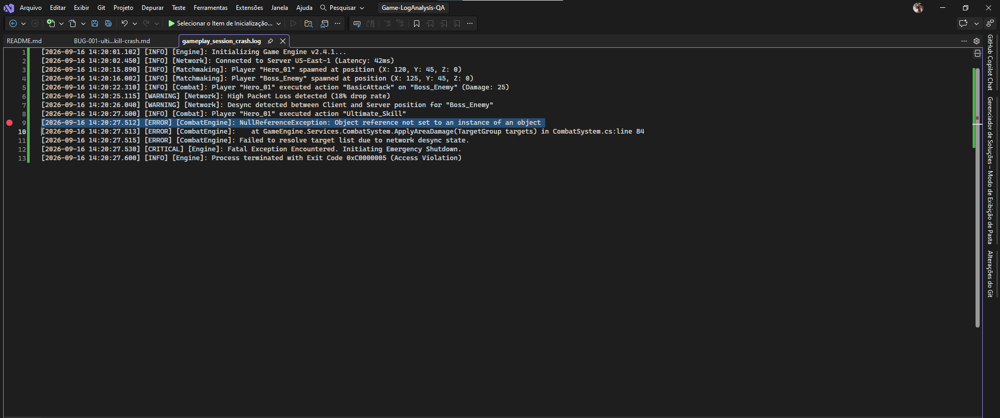
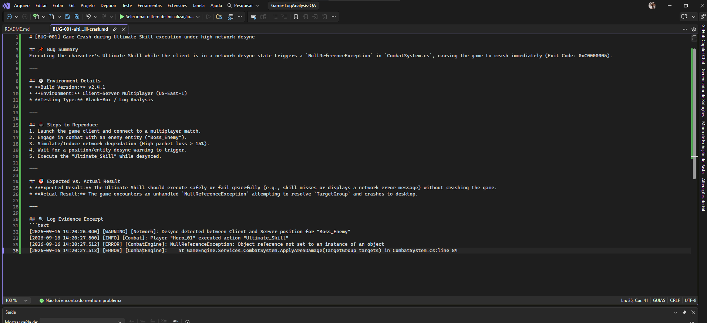

# 🔍 Game Engine Log Analysis & Crash Investigation

## 📌 Overview
This repository demonstrates a Black-Box QA investigation strategy. The objective was to diagnose a critical game crash in a multiplayer session using execution logs without direct source code modification.

---

## 🛠️ Tools & Methods
* **Analysis Tool:** Visual Studio Log Inspection
* **QA Methodology:** Black-Box Testing, Root Cause Analysis (RCA), Log Parsing
* **Deliverables:** Technical Bug Report & Log Evidences

---

## 📸 QA Process & Log Evidences

### 1. Log File Inspection
Tracing timestamps to locate the exact point of execution failure and exception stack trace.

---

### 2. Formal Bug Documentation
Detailed documentation of steps to reproduce, impact assessment, and log excerpts for engineering teams.

---

## 📄 Full Bug Report
👉 [BUG-001-ultimate-skill-crash.md](./reports/BUG-001-ultimate-skill-crash.md)